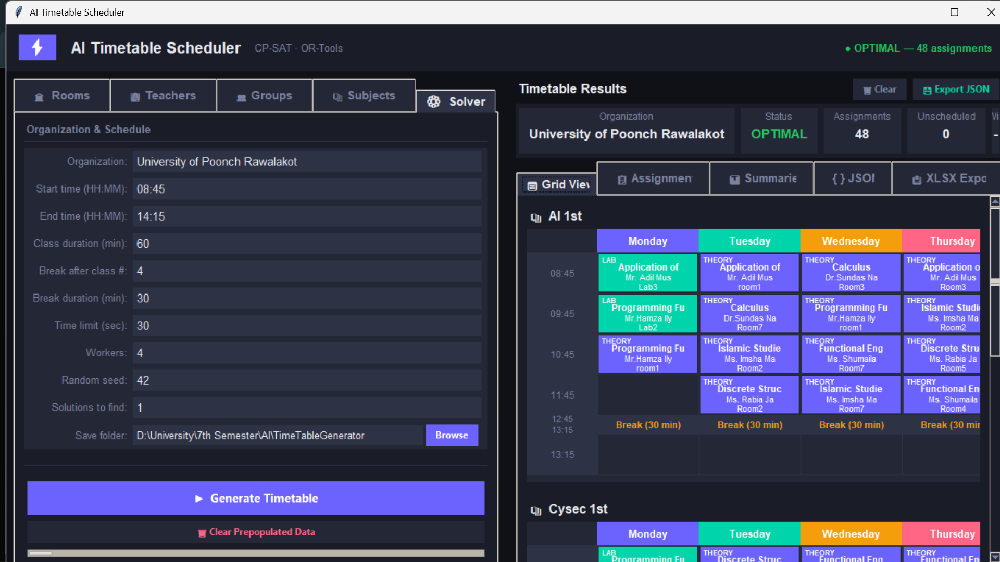
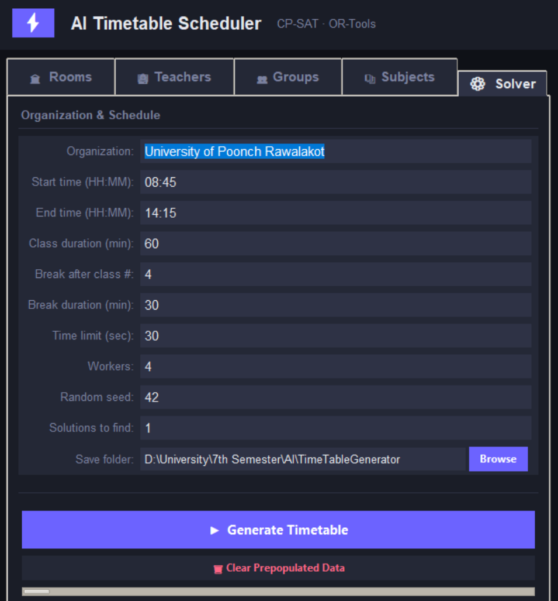
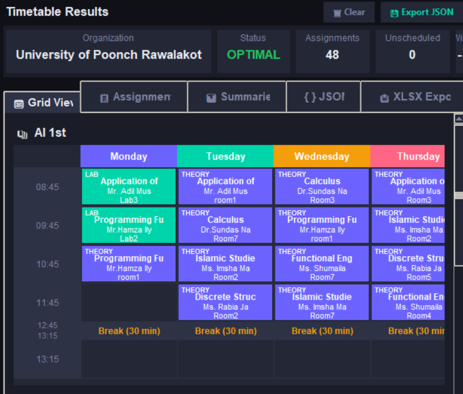
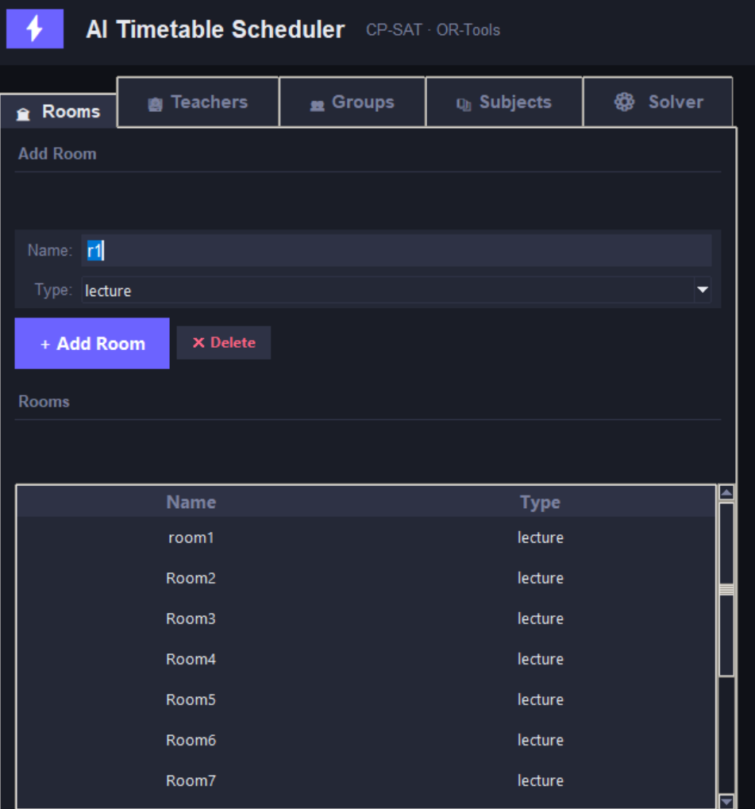
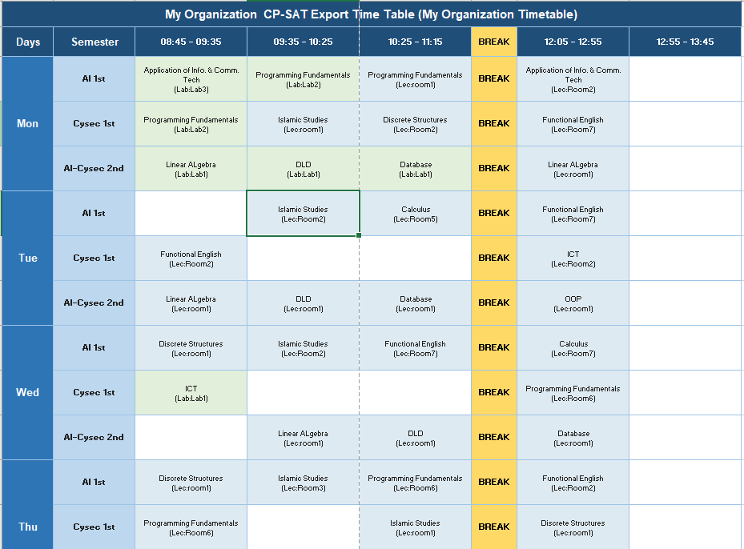

# University Timetable Scheduler

A high-performance, automated university timetable generator built with Python and Google OR-Tools. This application uses the CP-SAT solver to handle complex scheduling constraints, providing an optimized and conflict-free timetable for students, teachers, and rooms.



## 🚀 Tech Stack


---

## ✨ Features

- **Automated Scheduling:** Leverages Google OR-Tools CP-SAT solver to find optimal solutions for complex scheduling problems.
- **Constraint Management:** Handles hard constraints (no overlaps, room capacity) and soft constraints (teacher preferences, gap minimization).
- **Interactive UI:** Modern dark-themed GUI built with Tkinter for easy data entry and visualization.
- **Flexible Data Entry:** Manage rooms, teachers, student groups, and subjects with ease.
- **Visual Grid:** Real-time visualization of the generated timetable in a clean, color-coded grid.
- **Excel Export:** Professional-grade Excel export with automated formatting and styling using `openpyxl`.
- **Auto-Save:** Automatically saves every generated solution as a timestamped JSON file for later reference.

---

## 📸 Project Preview

### The Solver in Action

*Real-time solving status and constraint checking.*

### Grid Visualization

*Interactive color-coded timetable grid.*

### Data Management

*Efficient management of university resources.*

### Professional Export

*Formatted Excel output ready for distribution.*

---

## 🛠️ The Process

Building a university timetable scheduler is a classic **NP-hard problem**. The primary challenge was balancing the strict requirements (like avoiding teacher overlaps) with human preferences (like avoiding long gaps between classes).

### Challenges Faced
- **Lab Block Allocation:** Ensuring that 3-hour lab sessions are scheduled contiguously on the same day without being split by breaks.
- **UI Performance:** Rendering a complex 5-day grid for multiple student batches while maintaining a responsive interface.
- **Data Persistence:** Designing a flexible JSON schema that can store both the problem definition and the generated solution.

### What I Learned
- Deepened my understanding of **Constraint Programming** and how to translate real-world requirements into mathematical models.
- Mastered **Tkinter's advanced styling** to create a modern, dark-themed user experience.
- Improved skills in **Excel automation** and data visualization.

---

## 🚀 Setup Instructions

### Prerequisites
- Python 3.8 or higher
- `pip` package manager

### Installation

1. **Clone the repository:**
   ```bash
   git clone https://github.com/your-username/TimeTableGenerator.git
   cd TimeTableGenerator
   ```

2. **Install dependencies:**
   ```bash
   pip install ortools openpyxl
   ```

3. **Run the application:**
   ```bash
   python timetable_solver.py
   ```

---

## 💡 Room for Improvement
- [ ] **Web Integration:** Migrating the UI to a web-based framework like React or Flask.
- [ ] **Multi-Department Support:** Handling different departments with shared resources.
- [ ] **AI Optimization:** Using machine learning to predict teacher preferences based on historical data.
- [ ] **PDF Export:** Adding direct PDF export functionality alongside Excel.

---

## 📜 License
This project is licensed under the MIT License - see the LICENSE file for details.
